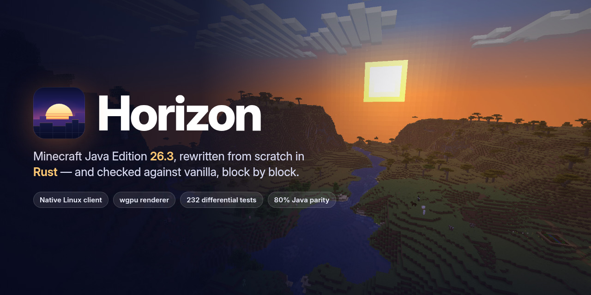

<p align="center">
  
</p>

<h1 align="center">Horizon 26.3 — Web Edition</h1>

<p align="center">
  <a href="https://aloneanqel1453.github.io/horizon.github.io/"><b>▶ TARAYICIDAN HEMEN OYNA (Horizon Global #1)</b></a>
</p>

---

## Nedir?

**Horizon 26.3 Web Edition**, Horizon (Vanilla 26.3 / Protokol 777) voksel motorunun mimarisi, `mining.rs` blok kırma fiziği, piksel gölgeli doku atlası, çok boyutlu dünya üretimi, canlı ekosistemi ve çok oyunculu ağ yapısının doğrudan modern tarayıcılarda (**Three.js + WebGL2 + Web Worker + WSS Gerçek Zamanlı Ağ**) çalışacak şekilde hazırlanmış sürümüdür.

- **Tek Ortak Varsayılan Sunucu (`Horizon Global #1`):** Sunucu kurma, port açma veya IP girme ekranı yoktur. Oyuncular yalnızca takma adını seçip doğrudan herkesin buluştuğu tek ortak dünyaya (`Seed #26031453`) katılır.
- **3 Boyut & Zengin Yapılar:**
  - **Ana Dünya (`Overworld`):** Otantik Başlangıç Köyü (Taş kuyu, altın köy çanı, demirci ocağı, köylü evleri, sulamalı buğday tarlası ve hazır Nether Geçidi), Çayır Vadisi, Kiraz Korusu, Akasya Savanı, Kızıl Kanyon (`Badlands`), Karlı Zirveler ve gizli hazineli Çöl Piramidi.
  - **Nether (`Nether`):** Kızıl & Çarpık Ormanlar, Ruh Kumu Vadisi, Kuvars & Işıktaşı kümeleri, Lav okyanusu ve **Nether Kalesi**.
  - **The End (`End`):** Merkez End Adası, 10 Obsidyen + End Kristali kulesi, **Ender Ejderhası Boss Savaşı** ve zafer sonrası açılan Ejderha Yumurtalı End Geçidi.
- **97 Blok, 50+ Eşya, Üretim & Kızıltaş Devreleri:**
  - 6 kademe (`Tahta, Taş, Demir, Altın, Elmas, Netherit`) 3B piksel-ekstrüde Kılıç, Kazma, Balta ve Kürekler; Yay & Ok, Kalkan bloklama, Ender İncisi, Su/Lav Kovaları, Çakmaktaşlı Çelik, Meşe Tekne, Çalışma Masası, Fırın eritme, Köy Sandıkları ve Köylü Zümrüt Takası.
  - 15 blok menzilli **Kızıltaş Tozu (`Redstone Dust`)**, Şalter, Kızıltaş Lambası, **Piston** blok itme ve zincirleme 3B TNT fiziği.
- **24 Canlı Türü + Binekler & Evcil Hayvanlar:**
  - Köylü, Demir Golem, **Bakır Golem (26.3)**, Koyun (makasla kırkma), İnek, Domuz, Tavuk, Tilki, Arı, Kutup Ayısı, **Binilebilir At & Deve**, **Kemikle Evcilleştirilebilir Kurt**, Zombi, Çöl Zombisi (`Husk`), İskelet Okçu, Creeper, Örümcek, Balçık, Enderman, Piglin (altın takası), Zombileşmiş Piglin, Blaze, Ghast ve **Ender Ejderhası**.
- **Atmosfer, 3B Işık & Hava Durumu:**
  - 3B BFS blok ışığı yayılımı (meşale, fırın, lav, ışıktaşı) + gökyüzü ışığı, 3B sürüklenen bulutlar, yağmur / kar / gök gürültülü fırtına (`/weather`), kiraz yaprağı taç yaprakları ve **Horizon Locator Bar**.

## Kontroller & Komutlar

- `W A S D` + `Ctrl` (Koşu) · `Space` (Zıpla / Yüz / Merdiven Tırman) · `Shift` (Kenar Korumalı Eğilme / Binekten İnme)
- `Sol Tık` Yakın Dövüş Saldırısı (Zıplarken Kritik Vuruş) / Aşamalı Blok Kırma · `Sağ Tık` Kalkan Savunması / Eşya Kullanma / Blok Koyma / Köylü & Binek Etkileşimi
- `E` Envanter, Üretim, Fırın, Sandık, Köylü Takası & Yaratıcı Katalog · `F` Hayatta Kalma / Yaratıcı Uçuş Modu
- `T` veya `/` Global Sohbet & Komutlar: `/spawn`, `/nether`, `/end`, `/summon <tür>`, `/weather <clear|rain|snow|thunder>`, `/gamemode <0|1>`, `/time <day|sunset|night>`, `/rtp`, `/tp`, `/heal`, `/list`, `/seed`
- `Tab` Canlı Sunucu Oyuncu & Ping Listesi · `F5` Duvar Korumalı 1./3. Şahıs Kamera · `F3` Teknik Bilgi Paneli

## Kaynak Koddan Derleme

```bash
cd app
npm install
npm run build
```

Derleme çıktıları otomatik olarak kök dizine (`index.html`, `assets/`, `fonts/`, `brand/`, `.nojekyll`) senkronize edilir ve GitHub Pages üzerinde doğrudan çalışır.

## Lisans

[MIT](LICENSE)
